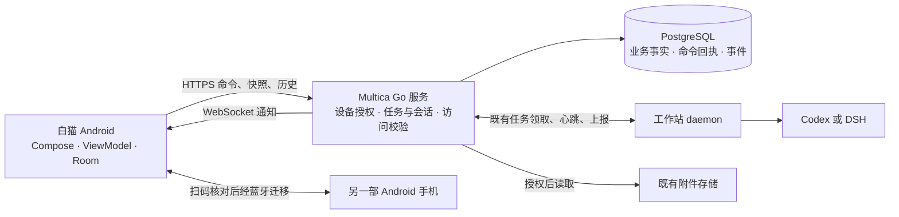

# 白猫远程任务台 · Orca 研究与前后端设计

2026-11-26 · 设计稿 v1，配套 [实施计划](PLAN.md)

白猫的第一版要让人离开工作站后仍能把一件事做完。例如在 Android 手机上把“核对塔架图纸”交给 CAD 工作站的 Codex，离开网络几分钟，再回来能看到同一次运行、完整回复和交付文件；换手机后仍能继续这个会话。这条路径决定首版的页面、数据和服务边界。

建议让 Android 用 Kotlin、Jetpack Compose 和 Room 独立实现现有白猫设计；业务后端在现有 Multica Go 服务内扩展，沿用 PostgreSQL、daemon 和 Agent 适配器。第一条真实链路选 Codex，第二个适配器用现有 DeepSeek Harness 验证能力差异。默认按组织内部试点、服务端和工作站可控设计；尚未确认正式分发方式、可修改的部署版本或可用真机。

## 一、从 Orca 学到什么

用户指定的章节索引于 2026-11-24，指向提交 `d55ba30b`。Orca 将用户自己的本地或远程机器、工作区和 Agent 连在一起，桌面提供终端与聊天两种操作面，手机可以在 Agent 需要人介入时读进展、回复和继续任务。工作树、编辑器、PR 和多 Agent 编排服务于桌面开发流程。白猫首版取其中的会话、执行状态与人工介入机制。[指定章节](https://deepwiki.com/stablyai/orca/5.5-native-chat-interface) · [Orca 项目说明](https://github.com/stablyai/orca)

| 源码中核实的机制 | 对白猫的具体设计影响 |
| --- | --- |
| 桌面入口按模式进入结构化会话，或结合终端窗格身份、会话标识和 transcript 路径解析已有会话。[NativeChatView](https://github.com/stablyai/orca/blob/d55ba30b/src/renderer/src/components/native-chat/NativeChatView.tsx) | 手机保存服务端稳定的会话 ID。重新打开任务、切换工作站、运行结束后查看历史，都能找到原会话。 |
| 共享聊天合同使用可序列化 JSON，区分消息角色，并为 transcript、hook、终端回读定义来源优先级。会话日志类型约定追加保存、读取时处理旧版本。[聊天合同](https://github.com/stablyai/orca/blob/d55ba30b/src/shared/native-chat/native-chat-types.ts) · [日志类型](https://github.com/stablyai/orca/blob/d55ba30b/src/shared/agent-session/journal/agent-session-journal-types.ts) | 白猫首版消费服务端持久消息与执行记录。工具调用、结果和附件保留独立身份；没有结构化结果时显示“运行时未提供详情”。 |
| ACP 层把提供方的输入请求与应答方法关联。移动组件能区分仍待输入和已处理的请求。[ACP 适配](https://github.com/stablyai/orca/blob/d55ba30b/src/main/acp/acp-dialects/acp-dialect.ts) · [移动待输入行](https://github.com/stablyai/orca/blob/d55ba30b/mobile/src/session/native-chat/transcript/messages/MobileNativeChatAwaitingInputRow.tsx) | 只有运行时声明支持且存在待处理请求时，才给出审批控件。批准、拒绝和其他设备已处理都要留下可读回执。 |
| 手机按轮次聚合连续执行行，依据已结束、展开和回执状态计算显示内容。桌面只挂载窗口内的行，并维护行高和新消息标记。[移动轮次投影](https://github.com/stablyai/orca/blob/d55ba30b/mobile/src/session/native-chat/transcript/turn-state/use-mobile-native-chat-transcript-rows.ts) · [桌面窗口化列表](https://github.com/stablyai/orca/blob/d55ba30b/src/renderer/src/components/native-chat/viewport/virtualization/NativeChatTranscriptItems.tsx) | 白猫按一次回复折叠工具步骤，保留按需展开的原始记录。在读旧消息时出现“有新消息”，返回后保留原行和偏移。 |

## 二、手上已有的东西

白猫 [基础方案](移动工作台基础方案.md) 定义免输账号的手机体验、远程任务与近距离换机。[正式 Axure 文件](远程任务台-白猫移动版.rp) 已有 18 页及 65 处跳转，[HTML](白猫移动版-交互预览.html) 已验证 360/390 两档宽度。运行数字、蓝牙进度和回复仍是演示数据。[此前验收](操作记录.md)

| 本地核实结果 | 实施落点 |
| --- | --- |
| Multica 工作树基线 `3c5c8b245359`。现有 mobile 说明定位 iOS，代码包含 Expo/RN、React Query、实时订阅和安全凭据存储。任务记录已有按 `seq` 合并补拉和实时尾部的处理。[移动说明](../../independent-projects/multica-upstream/apps/mobile/README.md) · [查询](../../independent-projects/multica-upstream/apps/mobile/data/queries/chat.ts) · [订阅](../../independent-projects/multica-upstream/apps/mobile/data/realtime/use-chat-session-realtime.ts) | Android 从白猫原型实现，参照既有接口语义与竞态测试。现有 iOS 代码作为行为对照。 |
| Go 已提供会话创建、发消息、历史分页、运行记录、附件鉴权下载和 daemon 接口。发送处理器返回 `message_id` 和 `task_id`；分页接收 `before_created_at` 与 `before_id`。[路由](../../independent-projects/multica-upstream/server/cmd/server/router.go) · [聊天处理器](../../independent-projects/multica-upstream/server/internal/handler/chat.go) | 一次派发复用一次入队。聊天分页和下载沿用原合同，新增设备授权、命令幂等及整段会话的增量补偿。 |
| Daemon 负责注册、心跳、领取和上报。已有 Codex 实现；本地 DSH 桥 `571d7c036d15` 支持 stdio JSONL、工具结果、取消与会话恢复，README 明确当前没有交互式提问界面。[Codex 适配器](../../independent-projects/multica-upstream/server/pkg/agent/codex.go) · [DSH 桥](../../independent-projects/dsh-multica-runtime/README.md) | 手机只指定已授权 Agent。能力由服务端按实际执行端公布。DSH 首版不展示虚假的远程批准按钮。 |

白猫界面按自有原型独立实现。当前 Multica 许可分别列出第三方托管或商业嵌入、源自其 UI 的品牌保留，以及仅采用后端时的署名条件。内部试点的文档保留 Multica 来源和项目链接。若目标改为向客户提供托管服务或商业分发，在确定交付路线前核实相应授权；取得商业授权和取得 UI 品牌豁免是两个不同事项。[本地许可 Part I](../../independent-projects/multica-upstream/LICENSE) · [上游许可](https://github.com/multica-ai/multica/blob/main/LICENSE)

## 三、系统如何连起来



服务端持有任务、消息、执行结果和权限的权威状态。工作站持有模型供应商凭据和本地工具环境。手机持有可撤销的设备授权、已获准读取的缓存、草稿和阅读位置。手机离开网络时，工作站继续执行。首版使用已有 Go 进程和数据库；对客户端开放的路径要经过工作空间成员、会话所有者及 Agent 调用权限检查。

## 四、Android 前端如何做

启动时读本地设备授权与工作空间。有有效授权时，白猫开屏后自动进任务；首次使用时提供“连接工作站”和“从旧手机迁入”；凭据过期保留草稿并显示“重新授权”。原型上的“进入工作台”保留为交互演示入口。列表使用白猫版的黑白灰、工作站选择器、按项目分组和清晰的正文层级；运行状态同时用文字和符号表达。

| 原型页面 | 页面读写与异常行为 |
| --- | --- |
| 启动页、任务、任务详情 | 先读本地任务摘要，再刷新本工作空间。详情串起目标、当前执行、原会话和交付物。工作站离线时显示最后心跳，服务端已接受排队后才显示“已排队”。 |
| 新建任务、派发成功 | 保存目标、Agent 和本地草稿。提交一次产生一个命令 ID。等待回执期间显示“待确认送达”；收到真实任务号后才能进入成功状态。 |
| 聊天、完整会话、更早的消息、最新消息 | 搜索会话和已同步正文；离线结果标记范围。将原型拆开的早期/最新消息实现为同一会话的滚动状态。首屏定位第一条未读或目标运行，向上加载保留锚点；只有正在看底部时才自动跟随。 |
| 工具调用、附件详情 | 正文流式更新时保持同一行。工具按调用 ID 更新为运行、成功或失败；详情只展示获准返回的输入输出摘要。附件经授权下载，DWG 无预览时提供元数据和打开方式。 |
| Agent | 每个账号显示所属工作站、在线状态、授权及可用能力。机在线与 Agent 可派发分别判断；同名 Agent 不能跨工作空间互换。 |
| 设备迁移、原设备出码、核对与选择、迁移进度、传输暂停、迁移完成 | 同一迁移状态机驱动六页。显示数据范围、实际确认的字节数/条目数，以及“已导入”“待重新授权”的不同结果。拒绝权限、拒绝核对、空间不足或中断时保留可执行的返回路径。 |

**组件与状态**　 Compose 路由分为 `tasks`、`chat`、`agents`、`transfer`。ViewModel 向页面暴露不可变 `StateFlow`，Repository 合并 HTTP、WS 和 Room。Room 按工作空间、用户和会话隔离缓存；用稳定的 `messageId`、`callId` 作行键。聊天页使用 LazyColumn 和游标分页，阅读锚点保存 `messageId + offsetPx`；字体缩放或附件展开后重新定位该行。重建进程时恢复草稿、待确认命令和锚点。每个运行时的展示差异集中在消息投影层。设计适配 360/390 宽、系统字体放大、输入法与系统返回。[Android 架构指南](https://developer.android.com/topic/architecture) · [Paging 指南](https://developer.android.com/topic/libraries/architecture/paging/v3-overview)

## 五、后端对象和接口合同

| 对象 | 标识与关系 | 写入者和不变量 |
| --- | --- | --- |
| 白猫任务（拟增） | `desk_task_id`，关联 workspace、owner、主会话；`desk_task_session` 可挂后续会话 | Go 应用服务创建。产品任务是一项用户目标，可以跨多轮执行；一期首页只列白猫任务。一次操作走聊天入队，避免同时创建 Issue 再触发第二次执行。 |
| 会话、消息、运行（复用） | Multica `session_id`、`message_id`、`task_id`；白猫把最后一个称为 `run_id`。每次回复可产生新运行 | 服务端写入，daemon 上报。运行内的 `task_message.seq` 用于排序；最终助手回复按权威消息 ID 替换临时正文。 |
| 会话事件、命令回执（拟增） | 唯一键分别为 `(session_id,seq)`、`(workspace_id,actor_id,command_id)`；回执带操作类型、请求摘要及原响应 | 业务写入与回执同事务。事件在其来源事实的事务中入库；DB 提交后通知 WS。相同命令内容重发返回原回执，不同内容复用键返回 409。 |
| 设备与授权（拟增） | `device_id`、公钥指纹、owner、workspace、作用域、撤销时间；换机生成新授权 | 授权端与后端共同确认。读取附件、流订阅及写入时均重新检查当前权限，撤销后停止后续访问。 |
| 本地缓存与迁移 | Room 的 `draft`、`outbox`、`read_anchor`、`sync_cursor`、`transfer_chunk` | 手机写入。按来源命名空间和业务 ID 去重，确认命令与服务端事实核对后再移出 outbox。 |

**已存在的服务入口**　 现有移动 API 使用 Bearer 身份和 `X-Workspace-Slug` 选择工作空间；白猫设备授权需映射到有权限的既有用户。以下路径按本地路由列出，部署版本列入 M0 联调。[移动客户端合同](../../independent-projects/multica-upstream/apps/mobile/data/api.ts) · [Go 路由](../../independent-projects/multica-upstream/server/cmd/server/router.go)

| 用途 | 现有接口 | 使用约束 |
| --- | --- | --- |
| 会话与发送 | `GET/POST /api/chat/sessions`，`POST /api/chat/sessions/{sessionId}/messages` | 创建会话传 `agent_id`；发送传 `content`、可选 `attachment_ids`，返回 `message_id`、`task_id`、`queued` 等。白猫可靠发送走下表的幂等入口。 |
| 全文与执行详情 | `GET /api/chat/sessions/{sessionId}/messages/page`，`GET /api/tasks/{taskId}/messages` | 历史分页传成对的 `before_created_at`、`before_id`，使用响应 `next_cursor`；工具明细按运行内序号合并。 |
| 执行端与附件 | `GET /api/runtimes`，`GET /api/attachments/{id}/download`，`GET /ws`（WebSocket 升级） | 只展示可见运行时；下载校验附件归属。现有实时事件可通知视图失效，完整性由持久读模型保证。 |

**拟增合同**　 以下都挂在 `/api/mobile/v1` 下。首版与 Go 业务层同进程，调用原有权限及入队逻辑；先提取可参与同一事务的服务方法，避免用多次内部 HTTP 请求拼事务。既有 Web/iOS 调用方沿用旧合同。

| 方法、路径 | 请求 → 响应要点 |
| --- | --- |
| `POST /device-pairings`、`POST /device-pairings/{id}/approve`、`POST /device-pairings/{id}/redeem` | 已登录的工作站或已授权旧机发起限时挑战；审批绑定新设备公钥指纹、用户和 workspace；新机证明持有私钥后一次性兑换，服务端签发设备授权。另设已授权端撤销指定设备的 `DELETE /devices/{id}`，以及持钥刷新 `POST /device-grants/refresh`。 |
| `GET /tasks`、`GET /tasks/{id}`、`POST /tasks` | 创建传标题、首条指令、项目、Agent 及 `Idempotency-Key`；返回 `desk_task_id, session_id, run_id, message_id, status`。列表按工作空间筛选，详情列出关联会话/运行、附件与最近状态。 |
| `POST /sessions/{id}/messages` | 与已有发送请求兼容，增加幂等键，返回权威消息 ID 与运行 ID。发生网络超时用原键重试；同一键不能跨操作重用。 |
| `GET /sessions/{id}/snapshot`、`GET /sessions/{id}/events?after_seq=N` | 快照返回最近消息、待处理请求、活动运行和一致读下的 `through_seq`；增量按会话排序并分页，返回 `events, next_after_seq, has_more`。游标早于保留范围返回 410，客户端重取快照。 |
| `POST /requests/{id}/resolve` | 仅真实支持此能力的运行时启用；传 decision、期望版本和幂等键；检查执行对象、会话所有权、到期时间与版本。并发首个有效决定生效，其他设备按回执刷新。 |

一次“核对塔架图纸”的受理回执示例。示例标识为说明性的占位值。

```json
{"desk_task_id":"desk_01","session_id":"session_01","run_id":"run_01","message_id":"message_01","status":"queued"}
```

## 六、流式、断线和会话恢复

事件包含版本、会话序号、运行 ID、类型和有界载荷。现有 `task_message.seq` 的作用域是**一次运行**；新增 `session_event.seq` 覆盖**整段会话**。按会话锁定计数行分配提交有序序号，对来源事实建立唯一索引。在一致读中按原消息 ID/运行序号读取旧数据，增量从显式切换水位起算，避免同一历史被重复导入。

```json
{"v":1,"session_id":"session_01","seq":42,"run_id":"run_01","kind":"tool.completed","payload":{"call_id":"call_07","name":"读取图层","status":"ok","summary":"共 18 个图层"}}
```

1. 客户端先订阅授权会话并缓冲通知，再取带水位的快照；从水位之后向持久事件接口补拉，直到追平。WS 通知只负责唤醒拉取，应用回前台和重连也触发同一流程。
2. Room 同一事务内应用连续事件并保存游标。例如已存 40，先看到 42，就从 40 回补 41、42；重复 42 忽略。分页晚于 WS 尾部返回时合并稳定 ID，保留较新的尾部。
3. 正文增量按运行和临时消息身份合并，完成后以持久的助手消息替换；工具按 `(run_id,call_id)` 更新。界面可合批刷新，服务端保留可重放的正文分段和最终内容。网络恢复只恢复显示，不额外派发任务。
4. 发送时先在本地持久化命令键；即使提交成功后连接立即重置，重开仍使用同一键查询或重试。后端若无法在一次事务内保证“消息、入队、回执”一致，应在 M1 解决后再启用自动重试。

## 七、两种配对解决不同问题

**首次连接工作站**　 已登录并有相应权限的成员在工作站授权手机；手机生成 Android Keystore 设备密钥。扫码只引导到一次性挑战，工作站显示申请设备、工作空间和权限供确认，服务端在审批后绑定公钥。之后手机用短期访问凭据连接，提供“查看已授权设备”和“撤销”入口。没有旧手机时可以从工作站重新授权。[Android Keystore](https://developer.android.com/privacy-and-security/keystore)

**两台手机换机**　 旧机选择迁移范围，二维码携带短时会话、双方握手所需的公开参数。双方核对同一短码并由旧机确认，通过经过认证的加密通道在蓝牙上传输分块清单、聊天缓存和 Agent 账号引用。按块校验并落暂存区，双方记下最后确认块；全部校验成功后原子合并，取消或空间不足时可清理暂存，原机记录继续可读。首版不迁出模型密钥、旧设备私钥或会话令牌。新机在线换发自己的授权，不能授权时可阅读已迁内容并显示“待绑定”。配对采用经过审查的安全协议实现；示例短码只用于人工核对。蓝牙权限覆盖发现、广播、连接；不同厂商双真机测吞吐和后台中断，恢复时重新验证配对与授权。[Android 蓝牙权限](https://developer.android.com/develop/connectivity/bluetooth/bt-permissions)

## 八、验收与边界

第一版的验收以用户看得到的结果为准。真机能够创建一项真实任务、从另一网络重连读到同一次执行、查看一个有权限的真实附件、保留未发送草稿，并在两部设备间迁入所选范围。新设备审批、失效授权、权限收回、磁盘不足和消息重复都有可复现用例。日志仅记录命令关联 ID、事件序号、重连和补拉耗时，跳过聊天正文、配对载荷和凭据。

开发顺序、责任、测试输入和退出条件见 [PLAN.md](PLAN.md)。本次产出是设计与实施计划；真机、部署、运行时版本与对外分发方式留在相应里程碑验证。
