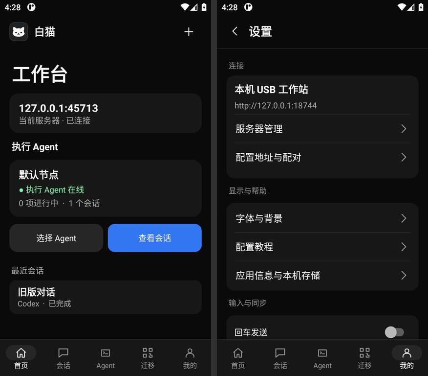

# 白猫远程工作台

白猫通过 Android 手机和 Web 界面把任务派发给已配对工作站上的 Codex CLI。每台服务器可以接入多个执行 Agent，每个 Agent 可以维护多段独立聊天。手机支持流式回复与工具进度、断线重连、继续追问，以及通过二维码迁移选中的本机资料。

## 安装与使用

- [下载白猫 Android 0.9.1 安装包](whitecat/android/白猫.apk)，最低支持 Android 8.0。
- [启动后端与工作站](whitecat/README.md)，按[手机安装与配对说明](whitecat/android/README.md)连接。
- [配置远程 daemon](whitecat/deploy/README.md)，或[在服务器上添加执行 Agent](whitecat/deploy/agents.md)。

Android 工作台底部的「我的」进入独立设置页，可调整外观、管理服务器、查看系统信息与应用私有目录。

## 源码与设计

- [Python API](whitecat/server.py)、[工作站进程](whitecat/worker.py)、[移动网关](whitecat/mobile_gateway.py)
- [Android 源码与构建说明](whitecat/android/README.md)、[Web 客户端](whitecat/web/)
- [当前 Axure 原型](白猫-独立设置导航.rp)、[开发计划](PLAN.md)

签名 APK 的 SHA-256 为 `8058e7bfabf54e759da6953cd2b078a174b736f971c216beb366d3886ba3815a`。运行数据库、配对凭据、签名私钥和本机操作日志保存在各自的工作环境。
